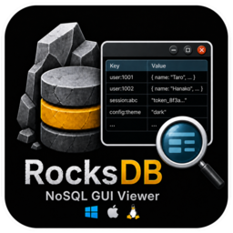
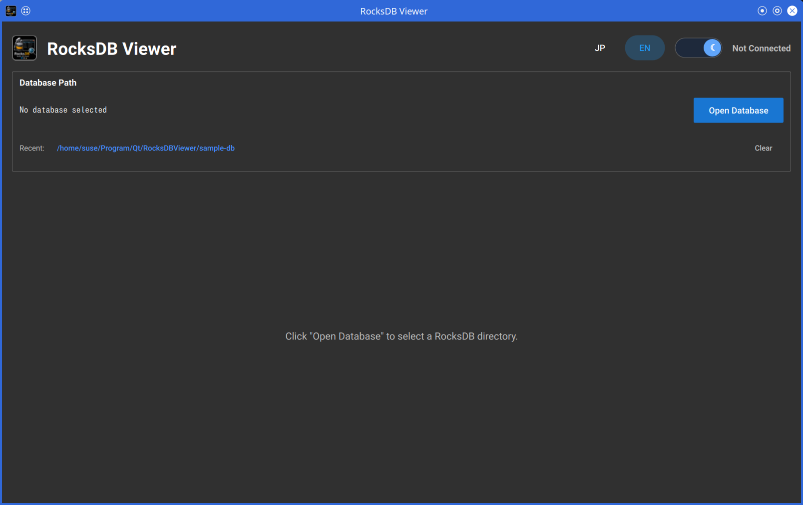
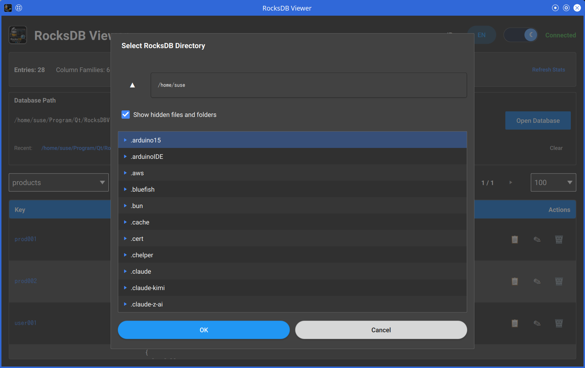
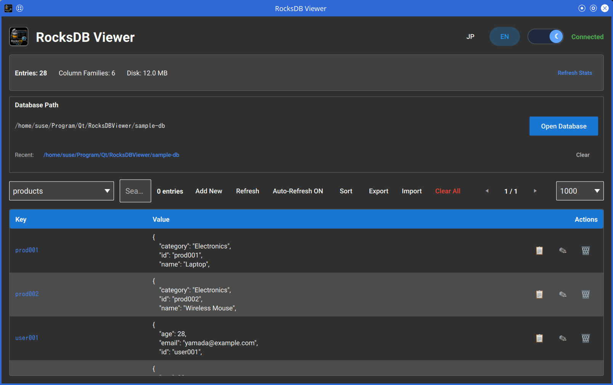
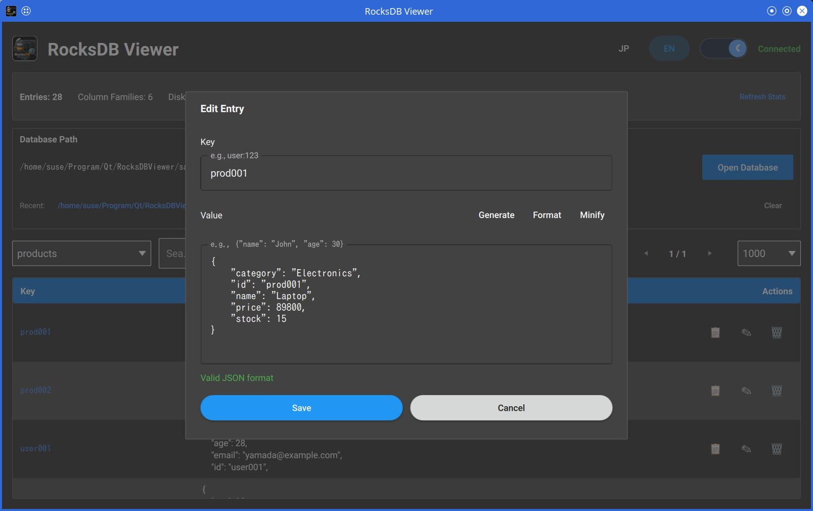

# RocksDB Viewer (Qt/QML Edition)

A desktop GUI application for browsing and editing RocksDB databases,  
built with **Qt 6.9 Quick (QML)** and **C++20**.  

This is a native reimplementation of the original Python/pywebview/HTML-based RocksDBViewer,  
offering the same feature set with native performance and no browser/WebView dependency.  


<p align="center">
  
  
</p>

## Screenshots

| Main Window | Select Database |
|:---:|:---:|
|  |  |
| **Database View** | **Edit Entry** |
|  |  |

## Requirements

- **Qt** 6.9 or later (tested with 6.9.1)
- **RocksDB** C++ library and headers (tested with 11.1.1)
- **CMake** 3.16 or later
- **C++ Compiler** with C++20 support (GCC 11+, Clang 14+, MSVC 2019+)

> **RocksDB requirement:**  
> The current CMake configuration does not search system paths for RocksDB automatically.  
> Set `ROCKSDB_ROOT` to a RocksDB installation or source-build directory that contains  
> `include/rocksdb/db.h` and either `lib/librocksdb.*` or `lib64/librocksdb.*`.  

## Supported Database Versions

Which databases can be opened depends on the version of the RocksDB library that RocksDB Viewer is built with.  
The deciding factor is the SST file format version (`BlockBasedTableOptions::format_version`) used when the database was written.  

| RocksDB library used for the build | Databases that can be opened |
|---|---|
| 11.10 or later | Written by RocksDB 4.6 or later (SST `format_version` 2–8) |
| 11.0 – 11.9 (tested: 11.1.1) | Written by RocksDB 4.6 or later (SST `format_version` 2–7) |
| 10.4 – 10.11 | Written by older RocksDB, or by newer RocksDB with default settings (SST `format_version` up to 7) |
| 9.x – 10.3 | Written by older RocksDB, or by RocksDB 10.10 or earlier with default settings (SST `format_version` up to 6) |

- RocksDB 10.11.0 changed the default `format_version` to 7. A build using RocksDB 9.x – 10.3 cannot open databases written by RocksDB 10.11 or later with default settings (`Corrupt or unsupported format_version: 7`).
- `format_version` 8 (RocksDB 11.10 or later) is used only when explicitly enabled.
- RocksDB 11.0 removed support for `format_version` 0 and 1 (the default before RocksDB 4.6). To open such a database, first run a full compaction with RocksDB 4.6 or later and earlier than 11.0.
- The compression algorithms used by the database must be compiled into the RocksDB library (RocksDB 11.5 or later uses LZ4 by default).
- Databases that require a custom comparator, merge operator, or other plugin not built into RocksDB cannot be opened, regardless of version.
- Read-only mode writes nothing to the database. In edit mode, new SST files are written with the `format_version` and compression recorded in the database's OPTIONS file, so the on-disk format is not upgraded to the library default.

See [`include/rocksdb/table.h`](https://github.com/facebook/rocksdb/blob/main/include/rocksdb/table.h) and [`HISTORY.md`](https://github.com/facebook/rocksdb/blob/main/HISTORY.md) in the RocksDB repository for details.  

## Build

### 1. Prepare RocksDB

Install RocksDB with your package manager when it is available, and set `ROCKSDB_ROOT` to that installation prefix.  

Example dependency installation commands:

#### RocksDB build dependencies

**RHEL**  

```bash
sudo dnf groupinstall "Development Tools"
sudo dnf install cmake git \
    snappy-devel zlib-devel bzip2-devel lz4-devel libzstd-devel gflags-devel
```

**SUSE**  

```bash
sudo zypper install -t pattern devel_basis
sudo zypper install cmake git \
    snappy-devel zlib-devel libbz2-devel liblz4-devel libzstd-devel gflags-devel
```

#### RocksDB Viewer build dependencies

**RHEL**  

```bash
sudo dnf groupinstall "Development Tools"
sudo dnf install cmake git \
    qt6-qtbase-devel qt6-qtdeclarative-devel qt6-qtquickcontrols2-devel qt6-linguist \
    rocksdb-devel
```

**SUSE**  

```bash
sudo zypper install -t pattern devel_basis
sudo zypper install cmake git \
    qt6-core-devel qt6-gui-devel qt6-quick-devel qt6-quickcontrols2-devel qt6-linguist-devel \
    rocksdb-devel
```

> **Note:**  
> If your distribution does not provide a suitable RocksDB package, follow the source-build instructions below.  
> If the distribution Qt packages do not satisfy the required Qt 6.9 or later,  
> install Qt 6.9 separately for your environment.  

If your package manager does not provide RocksDB,  
build it from source by following the official repository and install guide:  

- https://github.com/facebook/rocksdb
- https://github.com/facebook/rocksdb/blob/main/INSTALL.md

Example source build:  

```bash
git clone https://github.com/facebook/rocksdb.git
cd rocksdb
make shared_lib
# or: make static_lib
```

### 2. Configure

```bash
mkdir build && cd build

cmake .. -DROCKSDB_ROOT=/path/to/rocksdb \
         -DCMAKE_BUILD_TYPE=Release

# Or cmake with Qt path
cmake .. -DROCKSDB_ROOT=/path/to/rocksdb \
         -DCMAKE_PREFIX_PATH=/path/to/qt/6.9.1/gcc_64 \
         -DCMAKE_BUILD_TYPE=Release
```

### 3. Build

```bash
cmake --build . -j$(nproc)
```

## Run

```bash
# Launch without database
./RocksDBViewer

# Launch with a specific database path
./RocksDBViewer /path/to/your/rocksdb
```

> **Note:**  
> If the RocksDB shared library is not in the system library path,  
> set `LD_LIBRARY_PATH` to the RocksDB `lib` or `lib64` directory under `ROCKSDB_ROOT`:  

```bash
export LD_LIBRARY_PATH=/path/to/rocksdb/lib:$LD_LIBRARY_PATH
# or: export LD_LIBRARY_PATH=/path/to/rocksdb/lib64:$LD_LIBRARY_PATH
./RocksDBViewer
```

## Features

- **Native desktop GUI** — No browser or HTTP server required
- **Direct RocksDB access** — Uses the official RocksDB C++ API
- **Column Family support** — Browse and switch between multiple column families
- **CRUD operations** — Add, edit, delete, and clear all entries
- **Real-time search** — Filter entries by key or value content
- **Prefix search** — Quickly find keys starting with a specific string
- **Pagination** — Browse large datasets with configurable page sizes
- **Sort** — Toggle between original, ascending, and descending order
- **Database statistics** — Live display of entry counts, column families, and disk usage
- **JSON helpers** — Format, minify, validate, and generate skeleton templates in the editor
- **Import / Export** — JSON file I/O
- **Auto-refresh** — Optional 10-second interval polling
- **Recent databases** — Quick access to previously opened paths (up to 10)
- **Custom file picker** — Folder and file selection dialog with keyboard navigation
- **Internationalization** — Japanese / English language switch with persistent preference
- **Theme switch** — Light / Dark mode with persistent preference
- **Window state persistence** — Remembers size, position, and display preferences
- **Settings migration** — Automatic migration from legacy storage format
- **Keyboard shortcuts** — Quick access via keyboard for common actions

## Keyboard Shortcuts

| Shortcut | Action |
|----------|--------|
| Ctrl+O | Open database |
| Ctrl+R | Refresh data |
| Ctrl+N | Add new entry |
| Ctrl+F | Focus search field |
| Ctrl+T | Toggle theme |
| Ctrl+Q | Quit application |

## Project Structure

```
RocksDBViewer/
├── .github/                         # GitHub configuration
│   └── workflows/                   # GitHub Actions workflows
│       └── release.yml              # Release CI on v* tags (openSUSE RPMs, Windows zip)
├── assets/                          # Icons and images
│   ├── Qt.png                       # Qt logo used in README
│   ├── RocksDBViewer@128.png        # Application icon (128x128)
│   ├── RocksDBViewer@256.png        # Application icon (256x256)
│   └── RocksDBViewer@512.png        # Application icon (512x512)
├── docs/                            # Documentation
│   └── durability-testing.md        # Write durability / corruption test procedure
├── i18n/                            # Translation sources
│   ├── rocksdbviewer_en.ts          # English source strings
│   └── rocksdbviewer_ja.ts          # Japanese translations
├── licenses/                        # Third-party license texts
│   ├── Qt.md                        # Qt license information (LGPL v3)
│   ├── RocksDB-LICENSE.Apache       # RocksDB license (Apache License 2.0)
│   └── RocksDB-LICENSE.leveldb      # RocksDB license (BSD 3-Clause, from LevelDB)
├── qml/                             # QML user interface
│   ├── main.qml                     # Main window: layout, dialogs, and backend wiring
│   ├── Theme.qml                    # Light / dark theme colors
│   └── components/                  # UI components used by main.qml
│       ├── ControlBar.qml           # Search, sort, pagination, and data operation buttons
│       ├── DatabasePanel.qml        # Database path, Open Database button, recent databases
│       ├── DataTable.qml            # Entry list with edit / delete actions
│       ├── EditModal.qml            # Add / edit / view entry dialog with JSON tools
│       ├── FilePickerDialog.qml     # Custom folder / file picker for open and save
│       ├── HeaderBar.qml            # Title bar with language and theme switches
│       ├── SkeletonMenu.qml         # JSON skeleton template menu for EditModal
│       ├── StatsPanel.qml           # Database statistics (entries, column families, disk usage)
│       ├── ToastManager.qml         # Toast notifications
│       └── WelcomePage.qml          # Welcome screen shown when no database is open
├── sample-db/                       # Sample RocksDB data for local testing
├── screenshot/                      # Screenshots used in README
│   ├── edit_db.png                  # Edit entry
│   ├── main.png                     # Main window
│   ├── read_db.png                  # Database view
│   └── select_db.png                # Select database
├── src/                             # C++ sources
│   ├── main.cpp                     # Application entry point and QML bootstrapping
│   ├── backend/                     # Database access and data models
│   │   ├── EntryModel.h/.cpp        # QAbstractListModel for entry data
│   │   ├── FilterProxyModel.h/.cpp  # Search, sort, and pagination proxy
│   │   └── RocksDBBackend.h/.cpp    # RocksDB access, CRUD, import/export (QML singleton Backend)
│   └── utils/                       # Utility classes
│       ├── FileSystemModel.h/.cpp   # File system model for the custom picker dialog
│       ├── I18nManager.h/.cpp       # Runtime language switching (QML singleton I18n)
│       ├── JsonUtils.h/.cpp         # JSON formatting, minify, validate, skeleton helpers
│       ├── SettingsKeys.h           # Persistent settings key constants
│       └── SettingsMigration.h/.cpp # Settings storage migration helpers
├── tests/                           # Automated tests
│   ├── CMakeLists.txt               # QTest target registered with CTest (BUILD_TESTING)
│   ├── run_durability_test.sh       # End-to-end durability regression script
│   └── test_rocksdbbackend.cpp      # RocksDBBackend unit tests (QTest)
├── tools/                           # Development tools
│   └── create_sample_db.cpp         # Sample database generator (create_sample_db target)
├── CMakeLists.txt                   # Top-level build: app, tests, tools, install, CPack
├── LICENSE                          # MIT License
├── README.md                        # README (English)
├── README_JP.md                     # README (Japanese)
├── RocksDBViewer.desktop.in         # Linux desktop entry template
└── test-release-locally.sh          # Runs the release RPM build locally with Podman
```

## Updating Translations

After modifying source strings in `.cpp` or `.qml` files:

```bash
# Extract strings
lupdate src qml -ts i18n/rocksdbviewer_ja.ts i18n/rocksdbviewer_en.ts

# Edit .ts files (e.g., with Qt Linguist or text editor)

# Generate .qm files
lrelease i18n/rocksdbviewer_ja.ts i18n/rocksdbviewer_en.ts
```

## License

This project is licensed under the [MIT License](LICENSE).  

Third-party licenses:  
- [RocksDB](https://github.com/facebook/rocksdb) is licensed under the [Apache License, Version 2.0](https://github.com/facebook/rocksdb/blob/main/LICENSE.Apache)  
  and includes code under the [BSD 3-Clause License](https://github.com/facebook/rocksdb/blob/main/LICENSE.leveldb). See the `licenses/` directory for copies.  
- [Qt](https://www.qt.io/) is licensed under the [LGPL v3](https://www.gnu.org/licenses/lgpl-3.0.html).
