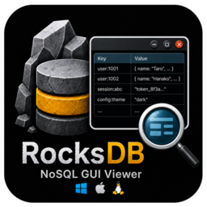
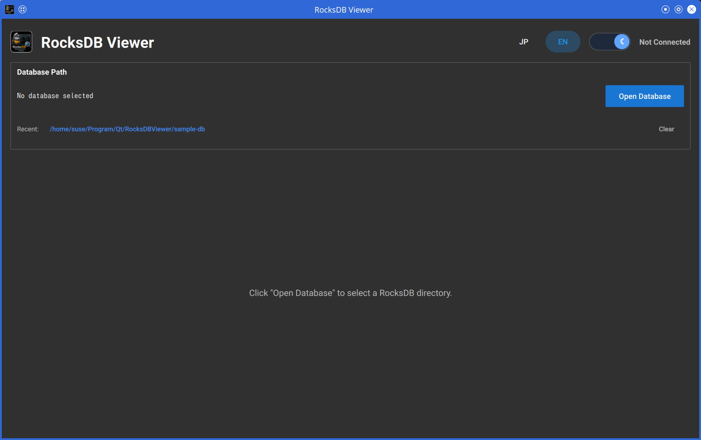
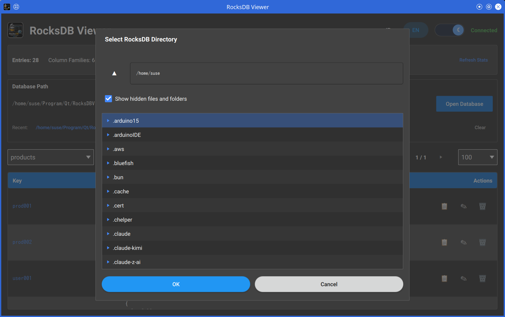
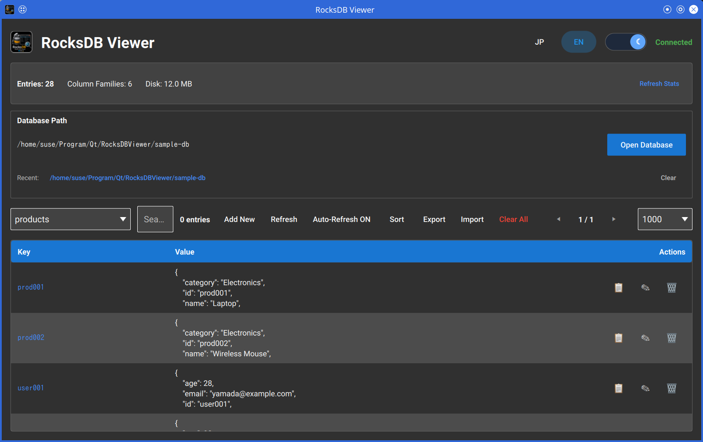
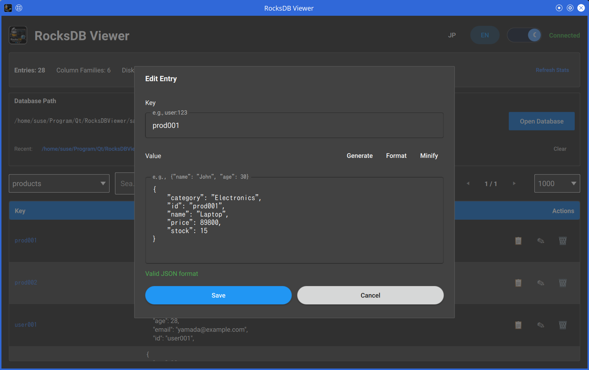

# RocksDB Viewer (Qt/QML Edition)

**Qt 6.9 Quick (QML)** および **C++20**で構築されたRocksDBデータベースの閲覧・編集用アプリケーションです。  
WebブラウザやWebViewに依存しないネイティブアプリケーションとして実装しています。  


<p align="center">
  
  
</p>

## スクリーンショット

| メイン画面 | データベース選択 |
|:---:|:---:|
|  |  |
| **データベース閲覧** | **エントリー編集** |
|  |  |

## 動作要件

- **Qt** 6.9以降 (動作確認済み: 6.9.1)
- **RocksDB** C++ライブラリおよびヘッダ (動作確認済み: 11.1.1)
- **CMake** 3.16以降
- **C++20** に対応したコンパイラ (GCC 11+, Clang 14+, MSVC 2019+)

> **RocksDBに関する注意:**  
> 現在のCMake設定では、RocksDBをシステムパスから自動探索しません。  
> `ROCKSDB_ROOT`オプションには、`include/rocksdb/db.h`と`lib/librocksdb.*`、または`lib64/librocksdb.*`を含むRocksDBのインストール先、  
> またはソースビルド先を指定してください。  

## 読み込めるデータベースのバージョン

開けるデータベースは、本アプリケーションのビルドに使用したRocksDBライブラリのバージョンによって決まります。  
判定の基準は、データベース書き込み時のSSTファイルフォーマットバージョン (`BlockBasedTableOptions::format_version`) です。  

| ビルドに使用したRocksDB | 開けるデータベース |
|---|---|
| 11.10以降 | RocksDB 4.6以降で書き込まれたもの (SST: `format_version` 2〜8) |
| 11.0 〜 11.9 (動作確認済み: 11.1.1) | RocksDB 4.6以降で書き込まれたもの (SST: `format_version` 2〜7) |
| 10.4 〜 10.11 | 旧バージョンで書き込まれたもの、および新バージョンで既定設定のまま書き込まれたもの (SST: `format_version` 7まで) |
| 9.x 〜 10.3 | 旧バージョンで書き込まれたもの、および RocksDB 10.10以前で既定設定のまま書き込まれたもの (SST: `format_version` 6まで) |

- RocksDB 10.11.0で`format_version`の既定値が7に変更されました。
  RocksDB 9.x 〜 10.3でビルドした場合、RocksDB 10.11以降で既定設定のまま書き込まれたデータベースは開けません。  
  (`Corrupt or unsupported format_version: 7`)  
- `format_version` 8 (RocksDB 11.10以降) は明示的に有効化した場合のみ使用されます。  
- RocksDB 11.0で`format_version` 0 / 1 (RocksDB 4.6より前の既定値) のサポートが削除されました。  
  該当するデータベースは、RocksDB 4.6～11.0未満でフルコンパクションしてから開いてください。  
- データベースが使用している圧縮方式がRocksDBライブラリに組み込まれている必要があります。(RocksDB 11.5以降の既定は`LZ4`)  
- RocksDBに組み込まれていない独自のcomparator、merge operator、プラグインを必要とするデータベースは、バージョンに関係なく開けません。  
- 読み取り専用モードではデータベースに何も書き込みません。  
  編集モードでは、新しいSSTファイルをデータベースのOPTIONSファイルに記録された`format_version`と圧縮方式で書き込むため、  
  ディスク上のフォーマットがライブラリの既定値に引き上げられることはありません。  

詳細は、RocksDBリポジトリの[`include/rocksdb/table.h`](https://github.com/facebook/rocksdb/blob/main/include/rocksdb/table.h)および[`HISTORY.md`](https://github.com/facebook/rocksdb/blob/main/HISTORY.md)を参照してください。  

## ビルド

### 1. RocksDBの準備

RocksDBをパッケージマネージャで導入できる場合は、そのインストールプレフィックスを`ROCKSDB_ROOT`に指定してください。  

依存関係パッケージのインストール例:

#### RocksDB をビルドする場合の依存関係

**RHEL**  

```bash
sudo dnf groupinstall "Development Tools"
sudo dnf install cmake git \
     snappy-devel zlib-devel bzip2-devel lz4-devel libzstd-devel gflags-devel
```

**SUSE**  

```bash
sudo zypper install -t pattern devel_basis
sudo zypper install cmake git \
     snappy-devel zlib-devel libbz2-devel liblz4-devel libzstd-devel gflags-devel
```

#### 本アプリケーションをビルドする場合の依存関係

**RHEL**  

```bash
sudo dnf groupinstall "Development Tools"
sudo dnf install cmake git \
     qt6-qtbase-devel qt6-qtdeclarative-devel qt6-qtquickcontrols2-devel qt6-linguist \
     rocksdb-devel
```

**SUSE**  

```bash
sudo zypper install -t pattern devel_basis
sudo zypper install cmake git \
     qt6-core-devel qt6-gui-devel qt6-quick-devel qt6-quickcontrols2-devel qt6-linguist-devel \
     rocksdb-devel
```

> **注意:**  
> ディストリビューションのリポジトリに適切なRocksDBパッケージがない場合は、以下のソースビルド手順を利用してください。  
> ディストリビューション付属のQtパッケージで**Qt 6.9以降**を満たせない場合は、環境に合わせて別途Qt 6.9を導入してください。  

パッケージマネージャにRocksDBが存在しない場合は、公式リポジトリおよびインストールガイドを参照してソースからビルドしてください。  

- https://github.com/facebook/rocksdb  
- https://github.com/facebook/rocksdb/blob/main/INSTALL.md  

ソースビルド例:  

```bash
git clone https://github.com/facebook/rocksdb.git
cd rocksdb
make shared_lib
# または: make static_lib
```

### 2. 構成

```bash
mkdir build && cd build

cmake .. -DROCKSDB_ROOT=/path/to/rocksdb \
         -DCMAKE_BUILD_TYPE=Release

# またはQtのパスを指定する場合
cmake .. -DROCKSDB_ROOT=/path/to/rocksdb \
         -DCMAKE_PREFIX_PATH=/path/to/qt/6.9.1/gcc_64 \
         -DCMAKE_BUILD_TYPE=Release
```

### 3. ビルド

```bash
cmake --build . -j $(nproc)
```

## 実行

```bash
# データベースなしで起動
./RocksDBViewer

# 特定のデータベースパスを指定して起動
./RocksDBViewer /path/to/your/rocksdb
```

> **注意:**  
> RocksDBの共有ライブラリがシステムのライブラリパスに含まれていない場合は、  
> `ROCKSDB_ROOT`ディレクトリ配下の`lib`または`lib64`を環境変数`LD_LIBRARY_PATH`に設定してください。  

```bash
export LD_LIBRARY_PATH=/path/to/rocksdb/lib:$LD_LIBRARY_PATH
# または: export LD_LIBRARY_PATH=/path/to/rocksdb/lib64:$LD_LIBRARY_PATH
./RocksDBViewer
```

## 機能一覧

- **ネイティブデスクトップGUI** - WebブラウザやHTTPサーバを必要としません
- **RocksDBアクセス** - RocksDB C++ APIを使用
- **カラムファミリー対応** - 複数のカラムファミリーを閲覧・切り替え可能
- **CRUD 操作** - エントリーの追加、編集、削除、全削除
- **リアルタイム検索** - キーまたは値の内容でエントリーをフィルタリング
- **プレフィックス検索** - 特定の文字列で始まるキーを迅速に検索
- **ページネーション** - ページサイズを変更可能なページ分割で大規模データを閲覧
- **ソート** - 元の順序、昇順、降順の切り替え
- **データベース統計** - エントリー数、カラムファミリー数、ディスク使用量をリアルタイム表示
- **JSON 補助機能** - エディタ内での整形、圧縮、検証、スケルトンテンプレート生成
- **インポート / エクスポート** - JSONファイルの入出力
- **自動更新** - 10秒間隔の自動ポーリング (オプション)
- **最近使用したデータベース** - 過去に開いたパスへ素早くアクセス (最大10件まで保持)
- **カスタムファイルピッカー** - キーボードナビゲーション対応のフォルダー・ファイル選択ダイアログ
- **国際化** - 日本語 / 英語の言語切り替え（設定の永続化対応）
- **テーマ切り替え** - ライト / ダークモード（設定の永続化対応）
- **ウィンドウ状態の保持** - サイズ、位置、表示設定を記憶
- **設定の自動移行** - 古い保存形式からの自動移行機能
- **キーボードショートカット** - よく使う操作をキーボードで素早く実行

## キーボードショートカット

| ショートカット | 動作 |
|----------|--------|
| `[Ctrl] + [O]` | データベースを開く |
| `[Ctrl] + [R]` | データを更新 |
| `[Ctrl] + [N]` | 新規エントリーを追加 |
| `[Ctrl] + [F]` | 検索フィールドにフォーカス |
| `[Ctrl] + [T]` | テーマを切り替え |
| `[Ctrl] + [Q]` | アプリケーションを終了 |

## プロジェクト構成

```
RocksDBViewer/
├── .github/                         # GitHub設定
│   └── workflows/                   # GitHub Actionsワークフロー
│       └── release.yml              # v*タグのプッシュ時のリリースCI (openSUSE/SLE RPM、Windows zip)
├── assets/                          # アイコン・画像
│   ├── Qt.png                       # README向けQtロゴ
│   ├── RocksDBViewer@128.png        # アプリケーションアイコン (128x128)
│   ├── RocksDBViewer@256.png        # アプリケーションアイコン (256x256)
│   └── RocksDBViewer@512.png        # アプリケーションアイコン (512x512)
├── docs/                            # ドキュメント
│   └── durability-testing.md        # 書き込み耐久性 / 破損検証手順
├── i18n/                            # 翻訳ファイル
│   ├── rocksdbviewer_en.ts          # 英語原文
│   └── rocksdbviewer_ja.ts          # 日本語翻訳
├── licenses/                        # サードパーティライセンス文書
│   ├── Qt.md                        # Qtのライセンス情報 (LGPL v3)
│   ├── RocksDB-LICENSE.Apache       # RocksDBのライセンス (Apache License 2.0)
│   └── RocksDB-LICENSE.leveldb      # RocksDBのライセンス (BSD 3-Clause、LevelDB由来)
├── qml/                             # QMLユーザインターフェース
│   ├── main.qml                     # メイン画面 (レイアウト、ダイアログ、バックエンド連携)
│   ├── Theme.qml                    # ライト / ダークテーマの配色
│   └── components/                  # main.qmlから使用するUIコンポーネント
│       ├── ControlBar.qml           # 検索、ソート、ページ送り、データ操作ボタン
│       ├── DatabasePanel.qml        # データベースパス、[データベースを開く]ボタン、最近使用したデータベース
│       ├── DataTable.qml            # エントリー一覧 (編集 / 削除操作付き)
│       ├── EditModal.qml            # エントリーの追加 / 編集 / 閲覧ダイアログ (JSON補助機能付き)
│       ├── FilePickerDialog.qml     # 開く / 保存用のカスタムディレクトリ・ファイル選択ダイアログ
│       ├── HeaderBar.qml            # タイトルバー (言語 / テーマ切り替え)
│       ├── SkeletonMenu.qml         # EditModal向けJSONスケルトンテンプレートメニュー
│       ├── StatsPanel.qml           # データベース統計 (エントリー数、カラムファミリー数、ディスク使用量)
│       ├── ToastManager.qml         # トースト通知
│       └── WelcomePage.qml          # データベース未接続時のウェルカム画面
├── sample-db/                       # ローカル検証用のサンプルRocksDBデータ
├── screenshot/                      # README向けスクリーンショット
│   ├── edit_db.png                  # エントリー編集
│   ├── main.png                     # メイン画面
│   ├── read_db.png                  # データベース閲覧
│   └── select_db.png                # データベース選択
├── src/                             # C++ソースコード
│   ├── main.cpp                     # アプリ起動処理とQML初期化
│   ├── backend/                     # データベースアクセスとデータモデル
│   │   ├── EntryModel.h/.cpp        # エントリーデータ向けQAbstractListModel
│   │   ├── FilterProxyModel.h/.cpp  # 検索・ソート・ページング用プロキシモデル
│   │   └── RocksDBBackend.h/.cpp    # RocksDBアクセス、CRUD、インポート/エクスポート (QMLシングルトン Backend)
│   └── utils/                       # ユーティリティクラス
│       ├── FileSystemModel.h/.cpp   # カスタムファイルピッカー向けファイルシステムモデル
│       ├── I18nManager.h/.cpp       # 実行時の言語切り替え (QMLシングルトン: I18n)
│       ├── JsonUtils.h/.cpp         # JSON 整形、圧縮、検証、スケルトン補助
│       ├── SettingsKeys.h           # 永続設定キー定数
│       └── SettingsMigration.h/.cpp # 設定ストレージ移行ヘルパー
├── tests/                           # 自動テスト
│   ├── CMakeLists.txt               # QTestターゲットの定義とCTestへの登録 (BUILD_TESTING)
│   ├── run_durability_test.sh       # 書き込み耐久性のエンドツーエンド回帰テストスクリプト
│   └── test_rocksdbbackend.cpp      # RocksDBBackendの単体テスト (QTest)
├── tools/                           # 開発用ツール
│   └── create_sample_db.cpp         # サンプルデータベース生成ツール (create_sample_db ターゲット)
├── CMakeLists.txt                   # トップレベルのビルド設定 (アプリ、テスト、ツール、インストール、CPack)
├── LICENSE                          # MIT License
├── README.md                        # README (英語)
├── README_JP.md                     # README (日本語)
├── RocksDBViewer.desktop.in         # Linuxデスクトップエントリーのテンプレート
└── test-release-locally.sh          # リリースCIのRPMビルドをPodmanでローカル実行
```

## 翻訳の更新

`.cpp`または`.qml`ファイルの原文を変更した後:  

```bash
# 文字列を抽出
lupdate src qml -ts i18n/rocksdbviewer_ja.ts i18n/rocksdbviewer_en.ts

# .tsファイルを編集（Qt Linguist やテキストエディタ等）

# .qmファイルを生成
lrelease i18n/rocksdbviewer_ja.ts i18n/rocksdbviewer_en.ts
```

## ライセンス

このプロジェクトは、[MIT License](LICENSE)のもとで公開されています。  

サードパーティのライセンス:  
- [RocksDB](https://github.com/facebook/rocksdb)は、[Apache License, Version 2.0](https://github.com/facebook/rocksdb/blob/main/LICENSE.Apache)
  および [BSD 3-Clause License](https://github.com/facebook/rocksdb/blob/main/LICENSE.leveldb) でライセンスされています。  
  詳細は、`licenses/`ディレクトリをご覧ください。  
- [Qt](https://www.qt.io/)は、[LGPL v3](https://www.gnu.org/licenses/lgpl-3.0.html)でライセンスされています。  
